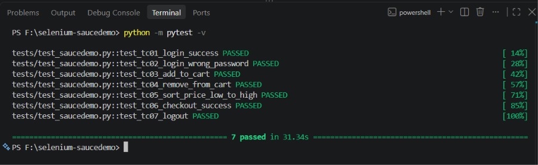

# BÁO CÁO THỰC HÀNH SELENIUM – KIỂM THỬ TỰ ĐỘNG WEBSITE

**Sinh viên:** Lê Đình Đức Anh  
**Mã sinh viên:** 23010219  
**Lớp:** Đánh giá và kiểm định chất lượng phần mềm - 1-1-26 (COUR01.LT2)  
**Môn học:** Đánh giá và kiểm định chất lượng phần mềm

---

## 1. Mục tiêu

Bài thực hành nhằm tìm hiểu và áp dụng công cụ Selenium WebDriver trong quá trình kiểm thử tự động website.

Các mục tiêu cụ thể:

- Tìm hiểu công cụ Selenium WebDriver và nguyên lý kiểm thử tự động.
- Sử dụng Selenium để điều khiển trình duyệt, định vị phần tử và thực hiện các thao tác trên website.
- Xây dựng tối thiểu 5 test case kiểm thử tự động.
- Sử dụng Pytest để tổ chức, thực thi và đánh giá các test case.
- Ghi nhận kết quả thực nghiệm và phân tích các lỗi phát sinh.
- Quản lý mã nguồn và trình bày báo cáo trên GitHub.

## 2. Công cụ và website được kiểm thử

### 2.1. Website kiểm thử

**Tên website:** SauceDemo (Swag Labs)

**Địa chỉ:** https://www.saucedemo.com/

SauceDemo là website thương mại điện tử mô phỏng, phục vụ cho việc học tập và thực hành kiểm thử phần mềm.

Website cung cấp các chức năng cơ bản như đăng nhập, xem danh sách sản phẩm, sắp xếp sản phẩm, thêm và xóa sản phẩm trong giỏ hàng, thanh toán và đăng xuất.

**Tài khoản kiểm thử:**

- Username: `standard_user`
- Password: `secret_sauce`

### 2.2. Công cụ sử dụng

| Công cụ            | Phiên bản / Mục đích               |
| ------------------ | ---------------------------------- |
| Python             | 3.14.0 – Ngôn ngữ lập trình        |
| Selenium WebDriver | 4.51.0 – Điều khiển trình duyệt    |
| Pytest             | 9.1.1 – Framework kiểm thử         |
| Google Chrome      | Trình duyệt thực thi kiểm thử      |
| Visual Studio Code | Viết và quản lý mã nguồn           |
| Git và GitHub      | Quản lý phiên bản và lưu trữ dự án |
| Windows            | Hệ điều hành thực thi              |

### 2.3. Nguyên lý hoạt động

Selenium WebDriver cho phép chương trình Python tự động tương tác với trình duyệt Chrome thông qua các lệnh điều khiển.

Quy trình kiểm thử:

1. Khởi tạo trình duyệt Chrome bằng Selenium WebDriver.
2. Truy cập website SauceDemo.
3. Xác định các phần tử HTML bằng ID, CSS Selector hoặc Class Name.
4. Thực hiện các thao tác như nhập dữ liệu, nhấn nút và lựa chọn sản phẩm.
5. Thu thập trạng thái hoặc nội dung hiển thị của website.
6. Sử dụng câu lệnh `assert` để so sánh kết quả thực tế với kết quả mong đợi.
7. Pytest tổng hợp và hiển thị trạng thái PASS hoặc FAIL.

Sử dụng `WebDriverWait` giúp chờ các phần tử xuất hiện hoặc có thể tương tác trước khi thực hiện thao tác.

## 3. Xây dựng các test case kiểm thử

Bài thực hành xây dựng 7 test case tự động, bao gồm các chức năng chính của website SauceDemo.

### 3.1. Bảng tổng hợp test case

| ID   | Chức năng                   | Kết quả mong đợi                       |
| ---- | --------------------------- | -------------------------------------- |
| TC01 | Đăng nhập hợp lệ            | Chuyển đến trang sản phẩm              |
| TC02 | Đăng nhập sai mật khẩu      | Hiển thị thông báo lỗi                 |
| TC03 | Thêm sản phẩm vào giỏ hàng  | Giỏ hàng chứa sản phẩm đã chọn         |
| TC04 | Xóa sản phẩm khỏi giỏ hàng  | Sản phẩm được xóa khỏi giỏ             |
| TC05 | Sắp xếp giá từ thấp đến cao | Danh sách sản phẩm sắp xếp đúng        |
| TC06 | Thanh toán đơn hàng         | Hiển thị thông báo đặt hàng thành công |
| TC07 | Đăng xuất                   | Trở lại màn hình đăng nhập             |

### 3.2. Chi tiết các test case

#### TC01 – Kiểm thử đăng nhập hợp lệ

**Mục đích:** Kiểm tra chức năng đăng nhập bằng tài khoản hợp lệ.

**Các bước thực hiện:**

1. Truy cập website SauceDemo.
2. Nhập username `standard_user`.
3. Nhập password `secret_sauce`.
4. Nhấn nút Login.
5. Kiểm tra trang sau khi đăng nhập.

**Kết quả mong đợi:** Chuyển đến `inventory.html` và hiển thị danh sách sản phẩm.

#### TC02 – Kiểm thử đăng nhập sai mật khẩu

**Mục đích:** Kiểm tra khả năng xử lý thông tin đăng nhập không hợp lệ.

**Các bước thực hiện:**

1. Truy cập website SauceDemo.
2. Nhập username `standard_user`.
3. Nhập một mật khẩu không chính xác.
4. Nhấn nút Login.
5. Kiểm tra thông báo lỗi.

**Kết quả mong đợi:** Website hiển thị thông báo lỗi và không cho phép truy cập trang sản phẩm.

#### TC03 – Kiểm thử thêm sản phẩm vào giỏ hàng

**Mục đích:** Kiểm tra chức năng thêm sản phẩm.

**Các bước thực hiện:**

1. Đăng nhập bằng tài khoản hợp lệ.
2. Chọn sản phẩm Sauce Labs Backpack.
3. Nhấn Add to cart.
4. Mở giỏ hàng.
5. Kiểm tra sản phẩm đã được thêm.

**Kết quả mong đợi:** Biểu tượng giỏ hàng hiển thị số lượng 1 và sản phẩm Sauce Labs Backpack xuất hiện trong giỏ.

#### TC04 – Kiểm thử xóa sản phẩm khỏi giỏ hàng

**Mục đích:** Kiểm tra chức năng xóa sản phẩm.

**Các bước thực hiện:**

1. Đăng nhập.
2. Thêm sản phẩm vào giỏ hàng.
3. Truy cập giỏ hàng.
4. Nhấn Remove.
5. Kiểm tra lại danh sách sản phẩm.

**Kết quả mong đợi:** Sản phẩm được xóa, giỏ hàng không còn sản phẩm và biểu tượng số lượng biến mất.

#### TC05 – Kiểm thử sắp xếp sản phẩm theo giá

**Mục đích:** Kiểm tra chức năng sắp xếp sản phẩm theo giá tăng dần.

**Các bước thực hiện:**

1. Đăng nhập.
2. Mở danh sách sản phẩm.
3. Chọn Price (low to high).
4. Lấy danh sách giá sản phẩm.
5. So sánh thứ tự giá.

**Kết quả mong đợi:** Các sản phẩm được sắp xếp từ giá thấp nhất đến giá cao nhất.

#### TC06 – Kiểm thử thanh toán đơn hàng

**Mục đích:** Kiểm tra quy trình thanh toán.

**Các bước thực hiện:**

1. Đăng nhập.
2. Thêm một sản phẩm vào giỏ hàng.
3. Mở giỏ hàng và chọn Checkout.
4. Nhập First Name, Last Name và Postal Code.
5. Nhấn Continue.
6. Kiểm tra trang tổng quan đơn hàng.
7. Nhấn Finish.
8. Kiểm tra thông báo xác nhận.

**Kết quả mong đợi:** Website chuyển đến trang hoàn tất thanh toán và hiển thị `Thank you for your order!`.

#### TC07 – Kiểm thử đăng xuất

**Mục đích:** Kiểm tra chức năng đăng xuất.

**Các bước thực hiện:**

1. Đăng nhập bằng tài khoản hợp lệ.
2. Mở menu điều hướng.
3. Chọn Logout.
4. Kiểm tra trạng thái trang.

**Kết quả mong đợi:** Người dùng được đưa trở lại màn hình đăng nhập.

## 4. Cấu trúc thư mục dự án

```text
selenium-saucedemo/
├── tests/
│   ├── conftest.py
│   └── test_saucedemo.py
├── .gitignore
├── pytest.ini
├── requirements.txt
├── test.png
└── README.md
```

**Chức năng các file:**

- `conftest.py`: Cấu hình Pytest fixture để khởi tạo và đóng trình duyệt.
- `test_saucedemo.py`: Chứa mã nguồn của 7 test case Selenium.
- `requirements.txt`: Danh sách thư viện cần cài đặt.
- `pytest.ini`: Cấu hình cho Pytest.
- `.gitignore`: Loại bỏ các file và thư mục không cần thiết khi đưa lên GitHub.
- `test.png`: Ảnh minh chứng kết quả chạy kiểm thử.
- `README.md`: Báo cáo và hướng dẫn thực hiện dự án.

## 5. Cài đặt và thực thi

### 5.1. Yêu cầu hệ thống

- Hệ điều hành Windows.
- Đã cài đặt Python 3.
- Trình duyệt Google Chrome.
- Visual Studio Code.
- Kết nối Internet để truy cập website kiểm thử.

### 5.2. Cài đặt thư viện

Mở Terminal trong Visual Studio Code tại thư mục dự án.

Tạo môi trường ảo:

```powershell
python -m venv .venv
```

Cài đặt thư viện:

```powershell
.\.venv\Scripts\python.exe -m pip install -r requirements.txt
```

Hoặc có thể cài đặt vào môi trường Python hiện tại:

```powershell
python -m pip install -r requirements.txt
```

### 5.3. Chạy toàn bộ test case

```powershell
python -m pytest -v
```

Sau khi chạy lệnh, Selenium tự động mở Google Chrome, thực hiện các thao tác trên website và hiển thị kết quả trong Terminal.

### 5.4. Chạy một test case cụ thể

Ví dụ chạy TC01:

```powershell
python -m pytest tests/test_saucedemo.py::test_tc01_login_success -v
```

Ví dụ chạy TC06:

```powershell
python -m pytest tests/test_saucedemo.py::test_tc06_checkout_success -v -s
```

### 5.5. Chạy ở chế độ Headless

Chế độ Headless cho phép Selenium thực hiện kiểm thử mà không hiển thị cửa sổ trình duyệt.

```powershell
$env:HEADLESS="1"
python -m pytest -v
Remove-Item Env:HEADLESS
```

Lệnh này áp dụng khi dự án đã cấu hình sử dụng biến môi trường `HEADLESS`.

### 5.6. Xuất báo cáo kiểm thử

Có thể xuất kết quả dưới định dạng XML bằng lệnh:

```powershell
python -m pytest -v --junitxml=results.xml
```

File `results.xml` sẽ lưu thông tin về các test case và kết quả thực thi.

## 6. Kết quả thực nghiệm

### 6.1. Thông tin thực nghiệm

- **Website kiểm thử:** https://www.saucedemo.com/
- **Hệ điều hành:** Windows
- **Python:** 3.14.0
- **Selenium:** 4.51.0
- **Pytest:** 9.1.1
- **Trình duyệt:** Google Chrome
- **Ngày thực hiện:** 21/10/2026

### 6.2. Bảng kết quả kiểm thử

Kết quả thực nghiệm từ lần chạy Pytest đã ghi nhận:

| ID   | Chức năng                  | Kết quả |
| ---- | -------------------------- | ------- |
| TC01 | Đăng nhập hợp lệ           | PASS    |
| TC02 | Đăng nhập sai mật khẩu     | PASS    |
| TC03 | Thêm sản phẩm vào giỏ hàng | PASS    |
| TC04 | Xóa sản phẩm khỏi giỏ hàng | PASS    |
| TC05 | Sắp xếp giá tăng dần       | PASS    |
| TC06 | Thanh toán đơn hàng        | FAIL    |
| TC07 | Đăng xuất                  | PASS    |

**Thống kê kết quả:**

- Tổng số test case: 7
- Số lượng PASS: 6
- Số lượng FAIL: 1
- Tỷ lệ thành công: 85,71%
- Tổng thời gian thực thi: 70,14 giây

### 6.3. Phân tích lỗi

Trong lần thực thi đã ghi nhận, TC06 gặp lỗi `TimeoutException`.

Lỗi xảy ra khi Selenium chờ nút `Finish` ở trạng thái có thể nhấn nhưng không tìm được điều kiện phù hợp trong thời gian chờ.

Nguyên nhân cụ thể chưa được xác định. Cần kiểm tra quá trình chuyển từ bước nhập thông tin thanh toán sang trang tổng quan đơn hàng, thông báo lỗi trên giao diện và trạng thái phần tử.

### 6.4. Ảnh minh chứng kết quả kiểm thử

Dưới đây là ảnh minh chứng quá trình thực thi kiểm thử tự động bằng Selenium và Pytest trên Visual Studio Code.



_Hình 1. Kết quả thực thi các test case Selenium trên Terminal._

### 6.5. Đánh giá kết quả

Kết quả thực nghiệm cho thấy Selenium WebDriver và Pytest đã thực hiện được các chức năng kiểm thử tự động trên website SauceDemo.

Sáu test case liên quan đến đăng nhập, giỏ hàng, sắp xếp sản phẩm và đăng xuất đã chạy thành công.

Test case thanh toán cần tiếp tục kiểm tra và khắc phục lỗi. Sau khi sửa, cần chạy lại toàn bộ bộ kiểm thử để xác nhận kết quả cuối cùng.

## 7. Nhận xét và hạn chế

### 7.1. Ưu điểm

- Selenium có thể tự động điều khiển trình duyệt Chrome và thực hiện các thao tác trên website.
- Pytest cho phép tổ chức và thực thi nhiều test case trong cùng một dự án.
- Có thể kiểm tra tự động kết quả bằng câu lệnh `assert`.
- Sử dụng `WebDriverWait` giúp giảm lỗi do phần tử chưa sẵn sàng.
- Có thể chạy lại nhiều lần để kiểm tra các chức năng sau khi cập nhật mã nguồn.
- Mã nguồn được tổ chức rõ ràng, thuận tiện cho việc bảo trì và mở rộng.

### 7.2. Hạn chế

- Bộ kiểm thử mới tập trung vào các chức năng cơ bản của website.
- Chưa thực hiện kiểm thử hiệu năng, bảo mật và kiểm thử tải.
- Chưa thực hiện kiểm thử trên nhiều trình duyệt và hệ điều hành khác nhau.
- Test case có thể bị ảnh hưởng nếu cấu trúc HTML hoặc dữ liệu của website thay đổi.
- Kết quả kiểm thử còn phụ thuộc vào tốc độ phản hồi của website và kết nối mạng.
- Chức năng thanh toán cần được tiếp tục kiểm tra để bảo đảm tính ổn định.

## 8. Kết luận

Thông qua bài thực hành, sinh viên đã tìm hiểu và áp dụng Selenium WebDriver kết hợp với Python và Pytest để xây dựng hệ thống kiểm thử tự động cho website SauceDemo.

Bài thực hành xây dựng được 7 test case, bao gồm đăng nhập, kiểm tra thông tin không hợp lệ, thêm và xóa sản phẩm khỏi giỏ hàng, sắp xếp sản phẩm, thanh toán và đăng xuất.

Kết quả chạy thực nghiệm ban đầu ghi nhận 6 test case thành công và 1 test case gặp lỗi cần khắc phục.

Quá trình thực hiện giúp sinh viên hiểu rõ hơn về cách xây dựng kịch bản kiểm thử, sử dụng công cụ tự động hóa, kiểm tra kết quả và phân tích lỗi trong quá trình kiểm thử phần mềm.

## 9. Tài liệu tham khảo

1. Selenium Documentation: https://www.selenium.dev/documentation/
2. Selenium Manager: https://www.selenium.dev/documentation/selenium_manager/
3. Sauce Labs Selenium Guide: https://docs.saucelabs.com/web-apps/automated-testing/selenium/
4. Pytest Documentation: https://docs.pytest.org/
5. Website thực hành SauceDemo: https://www.saucedemo.com/

---

**GitHub Repository:** https://github.com/canh8386/lab-9

**Sinh viên thực hiện:** Lê Đình Đức Anh – 23010219
